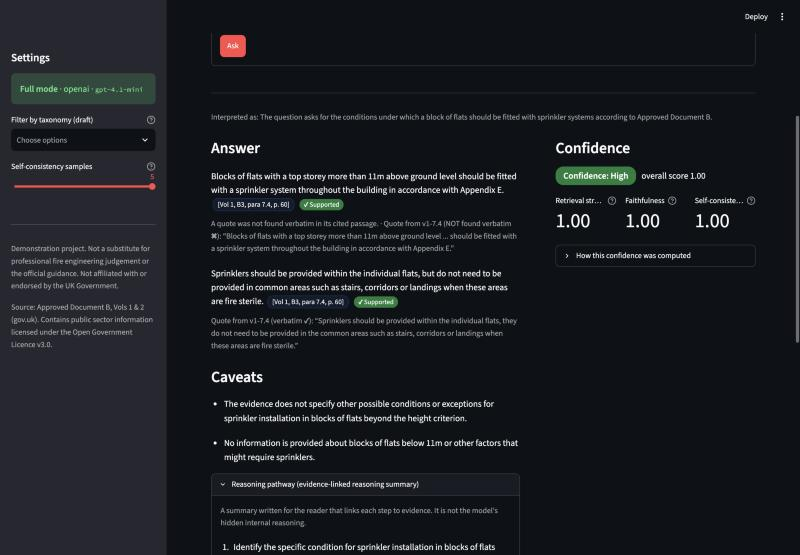
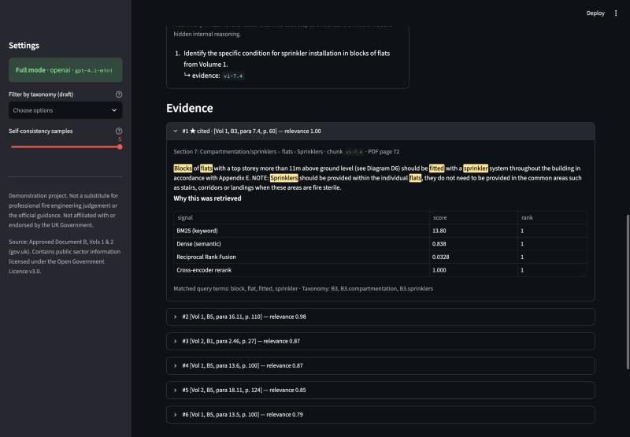
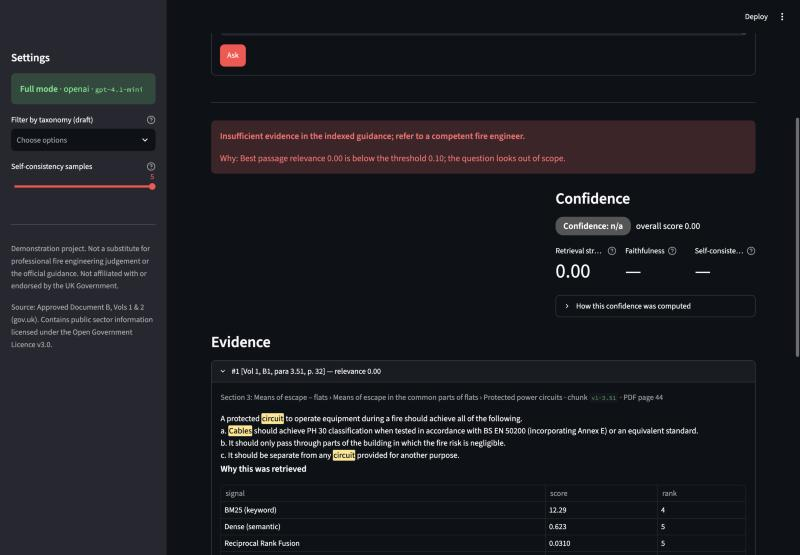
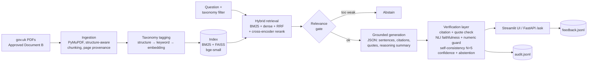

# Explainable Fire-Safety RAG

**Explainable RAG for safety-critical engineering guidance: source-attributed answers,
faithfulness checks, confidence scoring and abstention.**

Ask a question about the UK fire-safety guidance (Approved Document B, Volumes 1 and 2)
and get an answer where every sentence cites the clause, page and quoted text it relies on,
has been checked against that text by an independent model, carries a confidence breakdown,
and is withheld ("insufficient evidence") when the guidance doesn't support it.

| Answer with citations, faithfulness labels and confidence breakdown | Evidence: highlighted passage and why it was retrieved | Out-of-scope refusal |
|---|---|---|
|  |  |  |

> **Demonstration project. Not a substitute for professional fire engineering judgement or
> the official guidance. Not affiliated with or endorsed by the UK Government.**

---

## Why this matters

In safety-critical engineering, an AI answer you can't trace is a liability. A fluent but
unverifiable answer about travel distances, compartmentation or cladding is worse than no
answer, because it can be acted on. This project treats explainability as a set of
concrete, checkable guarantees:

- **Traceable:** every sentence carries citations to specific paragraphs/tables with the
  printed page number, plus a short quote that is checked verbatim against the source.
- **Checkable:** a separate, local NLI model tests whether the cited text actually
  *entails* each sentence; numbers in the answer must appear in the cited text; the model is
  resampled to see whether it gives the same answer twice.
- **Able to refuse:** weak evidence, out-of-scope questions, or unsupported drafts produce
  *"Insufficient evidence in the indexed guidance; refer to a competent fire engineer."*

## Architecture



Design decisions, trade-offs and failure modes are explained in plain English in
[docs/ARCHITECTURE.md](docs/ARCHITECTURE.md).

## XAI features, mapped to the questions a fire engineer would ask

| Engineer's question | What the system shows |
|---|---|
| **"Where did this come from?"** | Citation chips per sentence, e.g. `[Vol 2, B3, para 8.6, p. 65]`; the exact passage with query terms highlighted; a verbatim-checked quote; the validity marker when a passage is collated amendment text that is not yet in force. |
| **"Why did it pick these passages?"** | Per passage: BM25 score and rank, semantic similarity and rank, Reciprocal Rank Fusion rank, cross-encoder relevance, matched terms; taxonomy tags with the rule that produced each tag. |
| **"How sure is it?"** | A High / Medium / Low label **with its breakdown**: retrieval strength, faithfulness (share of sentences entailed by their citations), self-consistency across 5 resampled answers, the formula, and any caps that were applied. |
| **"How did it get there?"** | An *evidence-linked reasoning summary*: short steps, each listing the chunk IDs it relies on. It is a summary for the reader, **not** the model's hidden internal reasoning. |
| **"What would make it wrong?"** | Per-sentence labels (Supported / Partially supported / Unsupported) with the reason; removed invalid citations; non-verbatim quotes flagged; caveats from the model and from provenance (mixed volumes, table extraction, amendment dates). |
| **"What if it doesn't know?"** | It abstains, says why (e.g. *"Best passage relevance 0.00 is below the threshold"*), and still shows the closest evidence. |

## Evaluation

The evaluation set ([eval/questions.yaml](eval/questions.yaml)) has **20 questions written from
the text of the document**, each with its expected paragraph/table, and **5 out-of-scope
questions** (electrical cable sizing, planning permission, U-values, accessible parking, gas
safety). It is **illustrative and has not been reviewed by a domain expert.**

All numbers below were produced by running the code in this repository, using `eval/run_eval.py`
and `eval/perturbation_check.py`; raw per-question outputs are in [eval/results/](eval/results/).

Full mode uses `gpt-4.1-mini` (temperature 0 for the answer, 5 extra samples at 0.7 for
self-consistency). Retrieval-only mode needs no API key.

| Metric | Result | Count |
|---|---|---|
| Retrieval hit@5 (in-scope) | 95% | 19/20 |
| Retrieval MRR@5 | 0.90 |  |
| Abstention accuracy, out-of-scope (full pipeline) | 100% | 5/5 |
| Abstention, out-of-scope (retrieval gate only) | 60% | 3/5 |
| In-scope questions answered (not abstained) | 95% | 19/20 |
| Faithfulness: sentences Supported (NLI) | 91% | 39/43 |
| Faithfulness: Supported or Partially supported | 100% |  |
| Citation validity (cited ID was retrieved) | 100% |  |
| Quotes found verbatim in cited passage | 88% |  |
| Citation precision (cited passage entails sentence, NLI) | 91% |  |
| Citation precision (cited = expected paragraph; strict) | 76% |  |
| Mean self-consistency (answered in-scope) | 0.97 |  |
| Latency per question, mean / median / max (full, N=5, live calls) | 8.1s / 6.74s / 19.01s | 25 questions |
| Latency per question, mean (retrieval-only) | 0.38s |  |

| Verifier check on deliberately false claims | Variants | Still labelled Supported |
|---|---|---|
| number swap | 25 | 0% |
| negation | 41 | 10% |
| *(original, true sentences)* | 43 | 91% |

Model: `gpt-4.1-mini` · run 2026-10-05T00:24:59+00:00 · 5 consistency samples

**Definitions.** *hit@5*: an expected chunk is in the top 5 passages. *Faithfulness*: share
of answer sentences shown to the user that the NLI check labels Supported. *Citation precision
(NLI)*: share of citations whose passage alone entails the sentence citing it. *Citation
precision (strict)*: share of citations that are one of the question's expected paragraphs
(other relevant paragraphs count as misses). *Abstention accuracy*: share of out-of-scope
questions refused. The perturbation check doubles every number, or inserts "not", in each
accepted sentence, then re-runs verification against the same citations.

**How the verifier changed during development.** The verification layer was improved by
inspecting failures **on this same evaluation set**, so the final figures are optimistic.
The history, with raw results kept in `eval/results/`:

| Run | In-scope answered | Answer sentences labelled Supported |
|---|---|---|
| `gpt-4o-mini`, first verifier (live) | 15/20 | 29/33 (88%) |
| `gpt-4.1-mini`, second verifier (live) | 18/20 | 35/42 (83%) |
| `gpt-4.1-mini`, final verifier (same recorded generations, re-verified offline) | 19/20 | 39/43 (91%) |

The changes were generic fixes for problems in the NLI check, each documented in
[docs/ARCHITECTURE.md](docs/ARCHITECTURE.md):
- premises scored with and without provenance;
- sentence-level and list-aware premise windows;
- a deterministic numeric guard.

The perturbation check was added to make sure these fixes did not simply make the verifier
more lenient. The model changed between the first two runs because of free-tier API rate
limits.

### What these numbers do and don't say

- **Retrieval is strong on these questions** (19/20 in the top 5). The one miss (q03) retrieved
  the neighbouring paragraph (2.6, "two or more storeys") instead of 2.5 ("one storey").
- **Refusal works in two layers.** The relevance gate alone refused 3/5 out-of-scope
  questions. Planning permission and U-values share vocabulary with the guidance and were
  refused by the model. In-scope relevance never fell below 0.98 on this set, but the gate
  threshold is deliberately left low (0.10) rather than tuned to these 25 questions; see the
  sensitivity table in `eval/results/retrieval.json`.
- **The cost of caution is over-refusal.** One in-scope question (q16, vehicle access for
  small buildings) was withheld: the model's single long sentence combining a lead-in and both
  list items was not entailed by any premise window, so a correct answer was suppressed. In
  this design that is the intended failure direction, but it is still a failure.
- **"Faithfulness" here means *entailed by the cited text*, not *correct*.** It is measured by a
  small NLI model, which is itself fallible. 10% of negated false claims were still labelled
  Supported. 88% of quotes were verbatim; the rest were lightly paraphrased and are flagged
  in the UI.
- **Strict citation precision (76%)** is lower than NLI precision (91%) mainly because answers
  often cite a second relevant paragraph that wasn't the expected one (e.g. Volume 1 and
  Volume 2 equivalents).
- With 20 + 5 questions, a single question moves a rate by 5–20 points. These are
  illustrative numbers, not a benchmark.

## Governance and limitations

**Audit trail.** Every query is appended to `logs/audit.jsonl`: timestamp, question,
retrieved chunk IDs with their scores, provider and model, prompt version, the answer with
per-sentence faithfulness, the full confidence breakdown, and the abstention flag and reason.
When an answer is withheld, the withheld draft is kept in the log for review. This supports
transparency and record-keeping principles of the kind described in the EU AI Act.

**Data minimisation.** No user identifiers, IP addresses or session data are stored; email
addresses, UK phone numbers and postcodes typed into questions or feedback are redacted
before logging, in the spirit of GDPR data minimisation. **This project does not claim legal
compliance with the EU AI Act, GDPR or any other regulation.**

**Pilot feedback loop.** 👍/👎 plus an optional comment on every answer is stored in
`logs/feedback.jsonl`, linked to the audit record by query ID, so that pilot users' feedback
can drive changes to the prompt, thresholds, taxonomy and evaluation set.

**Taxonomy.** [taxonomy/fire_safety_taxonomy.yaml](taxonomy/fire_safety_taxonomy.yaml) is a
**draft taxonomy that would be validated with domain experts** before real use.

**Known limitations**
- The evaluation set is small (25 questions), written by a non-specialist, and not
  expert-reviewed; thresholds are conventional starting points, not calibrated values.
- The NLI model is small and imperfect: it can reject long or multi-part sentences that are
  in fact supported (over-refusal), and in a perturbation test it still accepted 10% of
  sentences that had been negated. Numeric changes are caught by a deterministic guard.
- Tables are rebuilt from word positions; table answers are capped at *Partially supported*.
- Diagrams are images: only their captions and labels are indexed.
- Neighbouring paragraphs with near-identical wording can be confused at retrieval time.
- The collated editions contain both current text and 2029 amendment text; both are indexed
  and labelled, and citing not-yet-in-force text triggers a caveat, but the user must still
  check which version applies.
- Only Approved Document B is indexed. It is guidance, not the Building Regulations
  themselves, and it is not the only route to compliance.

## Quickstart

Requires Python 3.11.

```bash
git clone https://github.com/tahami04/explainable-fire-safety-rag.git
cd explainable-fire-safety-rag
python -m venv .venv && source .venv/bin/activate
pip install -r requirements.txt
python scripts/download_data.py          # fetches the official PDFs from gov.uk
python -m firerag.ingest.build_index     # PYTHONPATH=src if not installed: pip install -e .
```

**Keyless, retrieval-only mode** (no API key, everything runs locally):

```bash
streamlit run app.py
```

You get ranked, explained evidence for any question, and out-of-scope refusals.

**Full mode** (grounded answers + verification):

```bash
cp .env.example .env      # then set OPENAI_API_KEY=... in .env (never commit it)
streamlit run app.py
```

**API:**

```bash
uvicorn firerag.api:app --app-dir src
curl -s localhost:8000/ask -H 'content-type: application/json' \
  -d '{"question": "What is a protected shaft?"}' | python -m json.tool
```

**Docker** (builds the index inside the image):

```bash
docker build -t firerag .
docker run -p 8501:8501 --env-file .env firerag
```

**Tests and evaluation:**

```bash
pip install -r requirements-dev.txt
pytest                                     # offline; LLM and models are mocked
python eval/run_eval.py --mode retrieval   # no key needed
python eval/run_eval.py --mode full        # needs a key; resumable if rate-limited
python eval/run_eval.py --mode full --replay   # re-verify recorded generations, no API calls
python eval/perturbation_check.py          # does the verifier reject false claims?
```

Optional local LLM: set `LLM_PROVIDER=ollama` and `OLLAMA_MODEL` in `.env`.

**Model choice.** The default is `gpt-4.1-mini`, a small, inexpensive model that supports
JSON output, temperature control and multiple samples per request. Newer small models also
work (`OPENAI_MODEL=gpt-5.4-mini` was tested). The evaluation used `gpt-4.1-mini` because the
account's free-tier limit allows 50 requests per day per model, and one full evaluation run
needs about 44.

**macOS notes.** The torch and faiss-cpu wheels each bundle an OpenMP runtime; the package
handles this on macOS only (see `src/firerag/__init__.py`) and checks FAISS results against
an exact NumPy search on every index load. If `pip install -e .` doesn't make `firerag`
importable (macOS can mark the editable-install `.pth` file as hidden), the entry points add
`src/` to the path themselves.

## Repository layout

```
app.py                     Streamlit UI
src/firerag/
  ingest/                  PDF parsing, structure-aware chunking, ligature repair, index build
  taxonomy/                taxonomy loading and explainable tagging
  retrieve/                BM25, dense (FAISS), RRF, reranker, retrieval explanations
  generate/                prompts, JSON schema, pluggable providers (OpenAI / Ollama), record/replay
  verify/                  citations, NLI faithfulness, numeric guard, consistency, confidence, caveats
  governance/              audit and feedback logs with PII redaction
  pipeline.py, api.py      orchestration and FastAPI
taxonomy/                  draft fire-safety taxonomy (YAML)
eval/                      questions, evaluation runner, perturbation check, results
docs/                      ARCHITECTURE.md, DEMO_SCRIPT.md
scripts/download_data.py   fetches the official PDFs (not committed)
```

## Next steps for a real deployment

- **Document connectors** (e.g. SharePoint, document-management systems) to index internal
  guidance, project reports and standards alongside public documents, with version tracking.
- **Expert-validated taxonomy** built with senior engineers, used for retrieval filters,
  training pathways and coverage analysis.
- **Human-in-the-loop review**: route Low-confidence and withheld answers to an engineer;
  their decisions become labelled data.
- **Calibration** of thresholds and confidence weights on expert-labelled answers.
- **Role-based access** and per-document permissions carried through retrieval.
- **Continuous evaluation**: a growing expert-reviewed test set run on every change to
  prompts, models or thresholds, with the perturbation check as a regression test.
- Retrieval improvements: following cross-references between paragraphs, structured table
  extraction, and an out-of-scope classifier.

## Licence and data attribution

Code: [MIT](LICENSE).

Data: *Approved Document B (fire safety), Volumes 1 and 2*, published on
[gov.uk](https://www.gov.uk/government/publications/fire-safety-approved-document-b).
Contains public sector information licensed under the
[Open Government Licence v3.0](https://www.nationalarchives.gov.uk/doc/open-government-licence/version/3/).
The PDFs are not redistributed here; `scripts/download_data.py` fetches them from gov.uk.
See [DATA_LICENCE.md](DATA_LICENCE.md).
